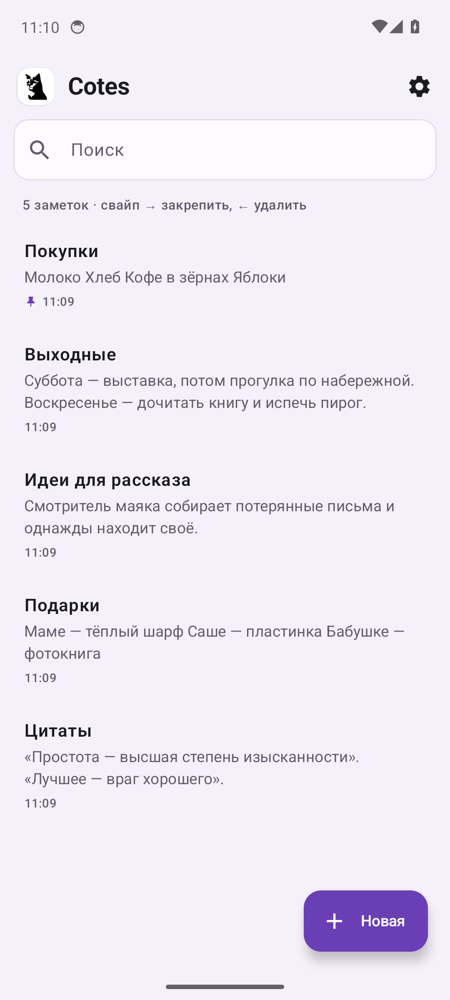
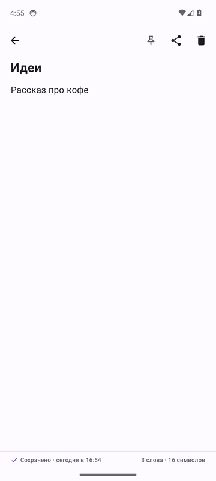
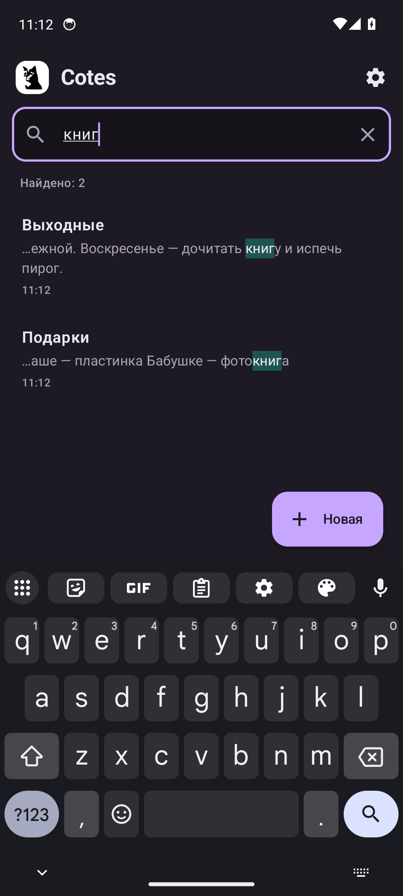
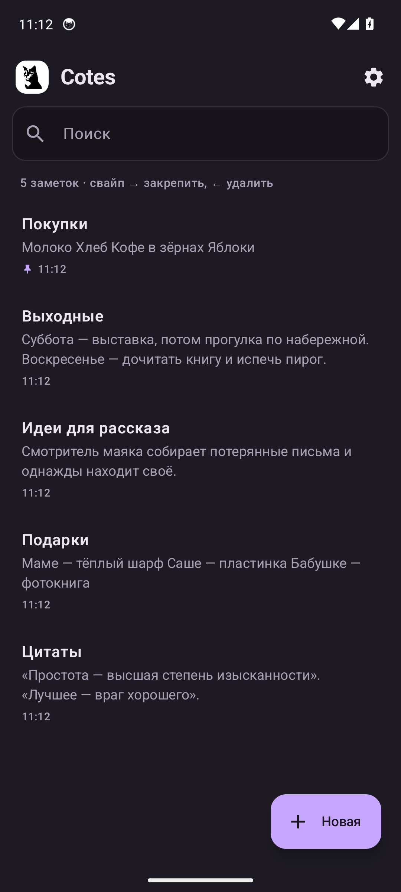

**Cotes** — минималистичные заметки для Android, которые хранятся только на вашем телефоне. Никаких подписок, аккаунтов и отправки данных на чужие серверы. Открыл — и пишешь.

_Cotes is a minimal notes app for Android that keeps your notes on your phone only — no accounts, no internet, no tracking. Available in English and Russian._

<p>
  
  
  
  
</p>

# 📲 Установка

Последняя версия — во вкладке [Releases](https://github.com/dantemorrigan/Cotes/releases): скачайте `Cotes-X.Y.Z.apk`, откройте его на телефоне и разрешите установку из этого источника. Нужен Android 8.0 или новее. Новые версии ставятся поверх старых, заметки сохраняются.

**Переход с версий до 1.0.** Начиная с 1.0 приложение подписано новым ключом, поэтому поверх старой версии оно не встанет:
1. В старой версии: Настройки → «Резервная копия всех заметок».
2. Удалите старую версию и установите 1.0.
3. В 1.0: Settings → «Restore from backup» / Настройки → «Восстановить из копии».

Тестовые сборки из ветки `main` — в [Actions → Android build](https://github.com/dantemorrigan/Cotes/actions/workflows/android.yml), архив `Cotes-android-N`.

# 🚀 Возможности

- 💾 **Автосохранение.** Кнопки «Сохранить» нет: текст записывается, пока вы печатаете.
- 🔍 **Мгновенный поиск** по заголовкам и тексту с подсветкой совпадений.
- 👆 **Свайпы:** вправо — закрепить заметку наверху, влево — удалить, с кнопкой «Отменить».
- 📤 **«Поделиться»** заметкой в любое приложение; текст из другого приложения становится новой заметкой.
- ➕ **Ярлык «Новая заметка»** — долгое нажатие на иконку приложения.
- 📦 **Резервная копия** всех заметок в файл `.json` и восстановление из него.
- 🌍 **Английский и русский**, переключатель языка в настройках (на Android 13+ — и в системных настройках приложения).
- 👋 **Подсказки при первом запуске** — три коротких шага, только для новых пользователей.
- ⚙️ **Оформление:** системная, светлая или тёмная тема, чёрный фон для AMOLED, пять цветов акцента или цвета обоев (Material You), размер текста, компактный список.
- 📐 **Планшеты и альбомная ориентация:** список и заметка рядом.
- 🔒 **Приватность:** нет разрешения на интернет; заметки не попадают ни в облачный бэкап, ни в перенос на новый телефон. Подробно — в [PRIVACY.md](PRIVACY.md).
- 🛟 **Надёжность:** если файл заметок повреждён, Cotes не перезаписывает его, а предлагает сохранить копию.

# 🛠 Для разработчиков

```
android/                    приложение: Kotlin, Jetpack Compose, Material 3
  app/src/main/             код и ресурсы (тексты — res/values и res/values-ru)
  app/src/test/             юнит-тесты (JVM)
  app/src/androidTest/      сценарные тесты на эмуляторе
  scripts/regress.sh        прогон тестов на эмуляторе: en/ru × светлая/тёмная
  scripts/check-strings.sh  проверка, что в коде нет «зашитых» русских строк
  release.keystore.enc      ключ подписи, зашифрованный паролем из секрета
fastlane/metadata/android/  тексты, иконка и скриншоты для магазинов
docs/STORES.md              как публиковать в Google Play, RuStore, F-Droid
```

Сборка: `cd android && ./gradlew assembleDebug` (JDK 17, Android SDK 37). Проверки, как в CI: `./scripts/check-strings.sh && ./gradlew testDebugUnitTest lintRelease`.

**Тексты интерфейса** — только в `res/values/strings.xml` (английский, по умолчанию) и `res/values-ru/strings.xml`. Lint не пропустит строку без перевода, а `check-strings.sh` — русский текст прямо в коде.

**CI.** При каждом изменении в `android/` GitHub Actions запускает юнит-тесты и lint, собирает подписанный APK и прогоняет сценарии на эмуляторе Android 14 на двух языках в двух темах. Скриншоты публикуются в ветку `ci/android-screens`.

**Версии.** `versionCode` — число коммитов, `versionName` берётся из тега `vX.Y.Z` (между релизами — `X.Y.Z-dev.N`).

**Релиз.** `git tag v1.0.0 && git push origin v1.0.0` — workflow `Release` соберёт APK и AAB, проверит подпись и создаст GitHub Release с заметками из `fastlane/metadata/android/*/changelogs/`.

**Ключ подписи** хранится в репозитории только в зашифрованном виде (`android/release.keystore.enc`, AES-256), пароль — в секрете `RELEASE_KEYSTORE_PASSWORD`. Без пароля сборка подписывается отладочным ключом. Отпечаток сертификата — в `android/release-cert-sha256.txt`. Потеря пароля означает, что выпускать обновления поверх установленной версии будет нельзя.
